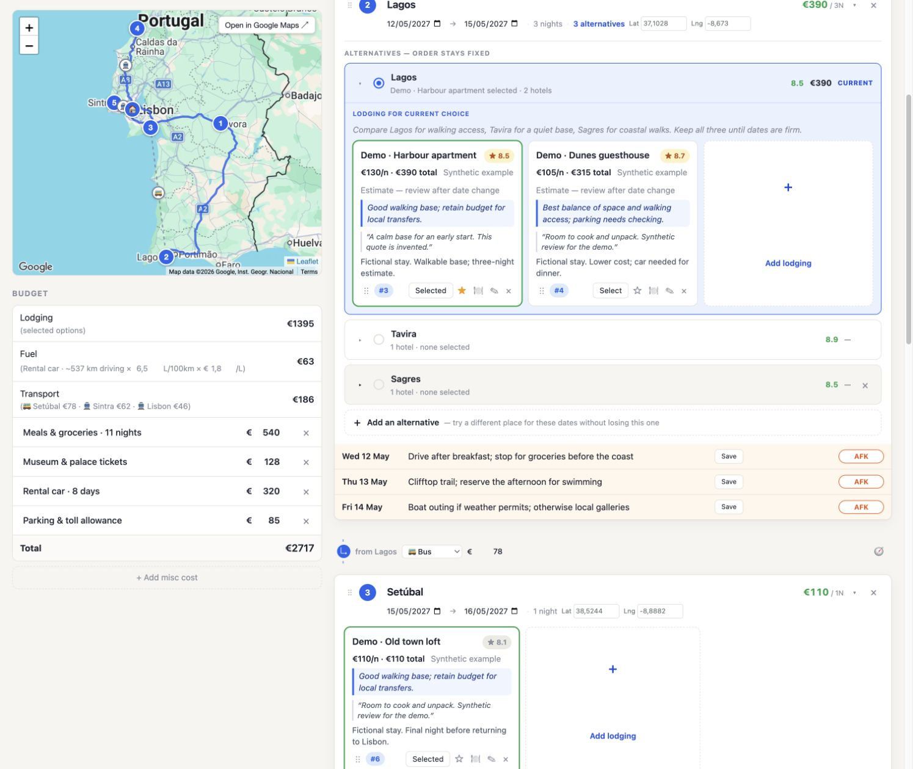
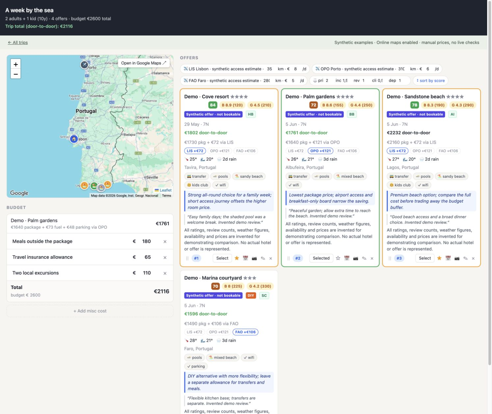

# Trip Dashboard

**Plan a trip without throwing away the alternatives.** Compare destinations and stays, swap one stop at a time, and see how each choice changes the route and budget.



A self-hosted planner for road trips and package holidays. Runs locally with Node.js and a browser. No account, API key or AI subscription is required for the demo.

## Keep your options open

- **Compare routes without starting over.** Keep several candidate destinations for the same dates. Swap one into the itinerary while preserving the others and their lodging.
- **Choose stays in context.** Compare prices, notes, ratings, favorites and rankings beneath each stop. Your selected stay updates the budget.
- **Plan the whole journey.** Combine driving, flights, trains, buses, ferries and transfers. Add ticket costs, fuel estimates, meals and other expenses.
- **Work through the details.** Stage date changes together, write daily plans, mark working days and days off, and clone a trip to explore another version.
- **Compare package holidays fairly.** Include airport access, parking and extras in the total, adjust comparison weights, and inspect entered date-and-price alternatives.
- **Use the map that fits your setup.** OpenStreetMap works without a key; Google Maps and place autocomplete are optional. An offline schematic remains available.



## Try it

Requires Node.js 22 or newer and npm. From the repository folder, in a macOS/Linux shell:

```bash
npm ci --ignore-scripts
TRIP_NETWORK=1 TRIP_DATA_DIR="$(mktemp -d)" npm run demo
```

Open the address printed by the server, normally `http://127.0.0.1:8090/`. Choose **The coast, two ways** or **A week by the sea**.

Try selecting another stay, swapping **Tavira** into the coastal slot, saving a daily plan, or opening the package date comparison. Your changes are saved locally. Demo startup copies only missing examples and never replaces existing trips.

For a persistent private workspace:

```bash
npm start
```

Trip files are stored in `~/.trip-dashboard/`. Set `TRIP_DATA_DIR` to use another directory outside the source tree, and back it up separately. The temporary directory in the demo command is for trying the app.

## Feature gallery

| View | What to look for |
| --- | --- |
| [Route and alternatives](docs/screenshots/roadtrip.jpg) | Five active stops, parked destinations, lodging choices and a running budget |
| [Daily planning](docs/screenshots/day-plan.jpg) | Saved daily notes and work/day-off status |
| [Transport and extras](docs/screenshots/transport.jpg) | Mixed travel modes, leg costs and additional expenses |
| [Date changes](docs/screenshots/trip-dates.jpg) | Stage and review dates before applying them |
| [Place search](docs/screenshots/place-search.jpg) | Optional Google suggestions and selected coordinates |
| [Trip cloning](docs/screenshots/clone.jpg) | Keep an independent version of an existing trip |
| [Package comparison](docs/screenshots/packages.jpg) | Full travel costs, airports, favorites and weights |
| [Date-and-price choices](docs/screenshots/package-dates.jpg) | Compare manually entered departure options |
| [All trips](docs/screenshots/index.jpg) | Road trips and package comparisons in one workspace |
| [Mobile layout](docs/screenshots/mobile.jpg) | The planner at a phone-sized browser viewport |

The screenshots show fictional stays, offers, prices, ratings, review quotes, weather figures and travel plans. Towns and map geography are real. Google screenshots use a separately configured runtime key; the keyless demo uses OpenStreetMap. Nothing shown represents a live offer, reservation or payment.

## Configuration and privacy

Export configuration in your shell; [`.env.example`](.env.example) is a reference and is not loaded automatically.

| Variable | Purpose |
| --- | --- |
| `PORT` | Local port; defaults to `8090` |
| `TRIP_DATA_DIR` | Private JSON directory outside the source tree |
| `TRIP_DEMO=1` | Copy missing synthetic examples on startup |
| `TRIP_NETWORK=1` | Enable online maps, routing and configured place lookup |
| `TRIP_USER`, `TRIP_PASS` | Set both to enable HTTP Basic authentication |
| `GOOGLE_MAPS_BROWSER_KEY` | Optional Google Maps JavaScript key |
| `GOOGLE_PLACES_API_KEY` | Optional server-side Places key for autocomplete and coordinates |
| `GOOGLE_PLACES_API_MODE` | Defaults to `new`; use `legacy` for an existing project with Legacy Places enabled |

The server binds to `127.0.0.1`. It is intended for one local user; trip files are not encrypted. With network mode off, no map, travel-provider or AI requests are made. Online mode sends map areas or route coordinates to the configured services. Place lookup sends your search text to Google when enabled.

Google keys belong in your environment, never in Git or trip files. Restrict the browser key to the Maps JavaScript API and your actual local origins; it is necessarily visible to your browser. Keep the separate Places key server-side. See [Google's API security guidance](https://developers.google.com/maps/api-security-best-practices).

Google Maps and Legacy Places were tested live. Places API (New) is implemented but has not been live-verified against an enabled project. Without configured Google services, use OpenStreetMap and manual coordinates. Omit `TRIP_NETWORK=1` for the offline schematic.

## Development

Express serves a plain JavaScript UI and JSON API. Leaflet renders the maps. Each trip is saved in its own JSON file through a temporary file and rename.

```bash
npm run check
npm test
npm audit --omit=dev
```

The [architecture and API guide](docs/architecture.md) covers the data model, endpoints and contributor setup. [Security notes](SECURITY.md) explain the privacy boundary. Tests use isolated synthetic data; CI checks Node.js 22 and 24.

## Scope and limits

This is a planning tool. Prices and availability are entered manually; selected cards record your choices without booking anything. Fuel costs and route distances are estimates. Date changes can leave full-stay prices marked for review. Budget displays use euros.

The public edition excludes account-based scraping, live availability checks, AI chat, background research workers, browser sessions and personal prompts. It has no multi-user account system, cloud sync or change history. Run one process per data directory. Some advanced configuration uses the JSON API rather than a dedicated form.

## License

[ISC](LICENSE). See [third-party notices](THIRD_PARTY_NOTICES.md) for bundled map libraries and dependencies.

AI coding assistance was used for public-edition preparation, testing and documentation. It is not required to run the app.
